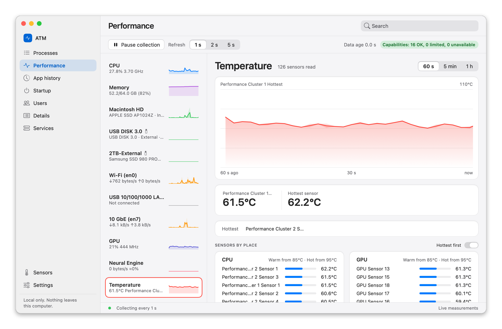
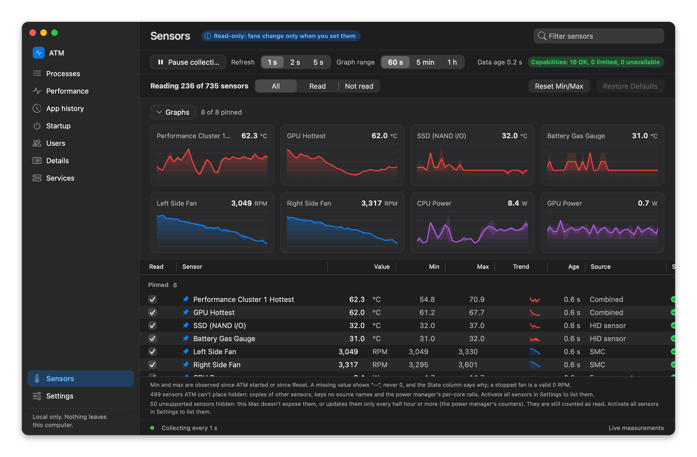

# ATM — Advanced Task Monitor for macOS

A task manager for your Mac with the numbers in the menu bar: CPU, memory, disk, network, battery,
temperatures, fan speeds and power. It shows every process, every disk and network interface, and hundreds of
the Mac's own sensors. Everything stays on your Mac.

  

**Version 1.0.0 Beta** (build 2026.1111.1) · macOS 15 Sequoia or later ·
[Download](../../releases/latest) · [Release notes](RELEASE_NOTES.md)

## Download

Pick the package for your Mac. Both are signed with a Developer ID and notarized by Apple.

| Your Mac | Package | macOS |
|---|---|---|
| **Apple silicon** (M1, M2, M3, M4 and later) | `ATM-1.0.0-beta-2026.1111.1-arm64.dmg` | 15 Sequoia or later |
| **Intel** | `ATM-1.0.0-beta-2026.1111.1-x86_64.dmg` | 15 Sequoia to 26 Tahoe |

Not sure which one you have? Open  › **About This Mac**. If the **Chip** line says Apple M-something, take
Apple silicon. If it lists a **Processor** made by Intel, take Intel.

Both downloads are on the [Releases](../../releases/latest) page.

## Install

1. Open the DMG you downloaded.
2. Drag **ATM** onto **Applications**.
3. Open ATM from Applications. It appears in the menu bar and opens its window.

The first time ATM starts, macOS may ask about Location Services. ATM asks only because macOS shows a Wi-Fi
network's name to apps that have it. ATM never reads your location. If you decline, everything else works, and the
Wi-Fi details say how to allow it later.

## What it shows

- **Menu bar.** Choose what sits in the menu bar: CPU, memory, network, disk, temperature, fans, power, battery,
  CPU, GPU and memory frequency, Bluetooth device batteries, or a clock with extra time zones. Click it for a popup
  with the last minute of each.
- **Processes.** Every app and background process with CPU, memory, disk and network use, grouped the way Windows
  Task Manager does. End a task from the row menu.
- **Performance.** Graphs for CPU (performance and efficiency cores, with their clocks), memory, each disk, each
  network interface, the GPU, the Neural Engine and temperature, over the last 60 seconds, 5 minutes or hour.
- **Run at login.** One switch in Settings › General opens ATM each time you log in.
- **App history, Startup, Users, Details, Services.** Which apps used the Mac this session, what starts at login
  (turn your own login items off and on), who is signed in, and the full process list.
- **Sensors.** Hundreds of temperature, fan, power, voltage and current sensors, with minimum, maximum, trend,
  age and where each value came from. Pin the ones you care about as graphs.

  

## Fan control and ATM's helper (optional)

ATM can set fan speeds from the menu bar popup. That needs ATM's helper, a small tool that runs with administrator
rights. ATM asks before installing it, and macOS asks you to approve it once in System Settings › General ›
Login Items & Extensions. The helper also lets ATM show every process's use, including other users' and the
system's, and on an Intel Mac the live CPU clock. Fans go back to automatic when ATM quits. Without the helper, ATM only reads the fans and never changes
them, and everything else keeps working. You can remove it at any time in Settings › Privacy › Remove Helper.

## Privacy

- **No network.** ATM has no accounts, no analytics, no ads and no update checks. It opens no network
  connections.
- **Read-only by default.** ATM reads sensors. It changes fan speeds only when you turn on fan control and set
  them, and it changes a login item only when you switch it.
- **Honest values.** A value ATM can't read shows as "—", never as 0, and stale values are marked stale. Every
  sensor shows where its value came from.

## Updates

ATM doesn't check for updates. To update, download the new DMG from [Releases](../../releases/latest) and drag
ATM onto Applications again, replacing the old copy. Your settings stay.

## Uninstall

1. If you installed ATM's helper, remove it first: Settings › Privacy › Remove Helper.
2. Quit ATM from its menu bar popup.
3. Drag ATM from Applications to the Trash.
4. Optional: delete `~/Library/Application Support/com.argacore.atm` (the app history) and
   `/Library/Logs/ATM` (the fan and startup change logs).

## Help map more Macs

Sensor names differ between Mac models. ATM's names come from the Macs we measured. For other models some names are
estimates and are marked unverified. You can help: in ATM, open **Settings › Developer › Collect sensor data**,
follow the steps, and attach the zip it saves to your Desktop to a new [issue](../../issues/new). The zip holds sensor
readings only. ATM checks every record for private details before it zips them.

## Known limitations of this beta

- The Intel package was tested on an Intel Hackintosh, not yet on a real Intel Mac. Sensor names and some readings
  may differ on real Intel Macs. Please report what you see.
- Sensor names for M3, M4, M5 and M6 Macs are partly estimated and will improve as people send data.
- Windows and Linux versions are planned and not available yet.

## Screenshots

| | Light | Dark |
|---|---|---|
| Performance | [view](screenshots/performance-light.png) | [view](screenshots/performance-dark.png) |
| Sensors | [view](screenshots/sensors-light.png) | [view](screenshots/sensors-dark.png) |

## License

ATM is proprietary software. Use is governed by its End User License Agreement.
Third-party notices are inside the app.
